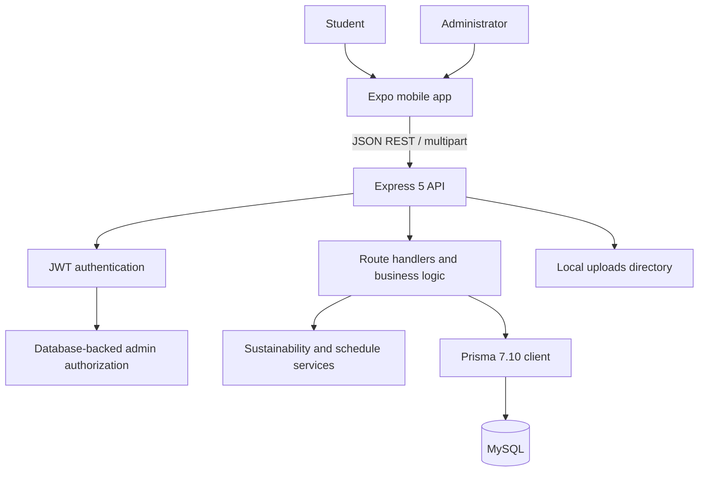
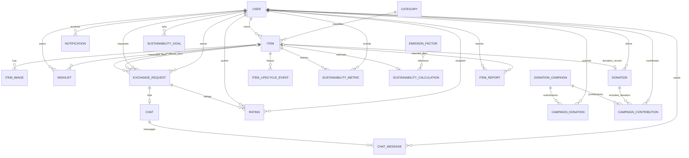

# ReUseHub – Smart Sustainable Campus Item Exchange

> A Campus Resource-Sharing Platform for Reuse, Exchange, Donation and Sustainable Consumption

**Document purpose:** single-source project and developer handover documentation, based on the repository implementation inspected on 7 October 2026. Update this document when code changes.

## 1. Project Overview

ReUseHub is a campus marketplace where registered students can list useful belongings for sale, exchange, or donation. Other students can search and filter listings, save items, request a transaction, coordinate an in-app handover, and review completed transactions. An administrator can moderate activity and manage donation campaigns.

The goal is to make existing campus resources easier to find and circulate. It is a reuse platform rather than only a conventional sales marketplace: exchanges and donations are supported alongside sales. Sustainability values shown in the application are estimates or activity counts, not verified environmental outcomes.

## 2. Problem Statement

Students may have books, electronics, clothing, or other useful belongings they no longer need while other students need the same kinds of items. Without a shared campus channel, finding those items and coordinating a safe handoff can be difficult. Useful goods may remain unused or be discarded while someone buys a replacement.

ReUseHub provides a searchable campus listing system and structured requests, exchanges, donations, handovers, and campaign submissions. It records completed activity so the community can see participation; its environmental calculations remain estimates with explicit limitations.

## 3. Motivation

The project applies circular-economy and responsible-consumption ideas at campus scale. A nearby reuse, exchange, or donation may help extend an item's useful life and can provide an alternative to purchasing a new item. The application organizes discovery and coordination; it does not establish that every reuse transaction prevents a new purchase.

## 4. Objectives

### Implemented objectives

- Register and authenticate members and administrators.
- Create, edit, browse, search, filter, save, and remove item listings.
- Support SALE, EXCHANGE, and DONATION listing types.
- Support item-for-item exchange offers, multiple pending requests, handover scheduling, verification codes, chats, and ratings.
- Run administrator-managed donation campaigns and accept student campaign submissions.
- Record transaction history, notifications, sustainability estimates, goals, achievements, and leaderboard points.
- Provide campus and administrator activity views.

### Not yet implemented

Verified campus-wide deployment, account email verification, cloud media storage, password reset, and measured lifecycle or energy assessments are not present in the current code.

## 5. Sustainable Development Goals

- **SDG 12 – Responsible Consumption and Production:** listing, exchanging, selling, and donating usable items supports reuse and more responsible consumption choices.
- **SDG 11 – Sustainable Cities and Communities:** a shared campus resource channel can strengthen local access and community participation.
- **SDG 13 – Climate Action:** reuse may reduce demand for replacement production. ReUseHub displays estimated CO2e where supported; it does not directly measure real-world emissions reductions.

These are project areas of relevance, not a claim of verified SDG impact.

## 6. Target Users

### Student / USER

Can register and log in, browse active listings, search and filter, save listings, list items, request sales/donations, make an item-for-item exchange offer, arrange a handover with an accepted counterparty, chat after acceptance, rate a completed transaction, view notifications, and view their activity and estimated impact.

### Administrator / ADMIN

Uses the same account system with a database-backed role. Admin screens provide campus statistics, listing and request views, reports/moderation, Green IT measurements, campaign creation and management, campaign image uploads, and donation submission review. Administrator routes enforce the role on the backend.

## 7. Major Functionalities

| Functionality | Current implementation | Status |
|---|---|---|
| Authentication | Registration, login, profile read/update, JWT, bcrypt | Implemented |
| Item listing | CRUD-style listing operations, category, condition, type, price and optional weight | Implemented |
| Sell | Sale price, negotiability, request/accept/handover/code completion | Implemented |
| Exchange | Requester selects an available item they own; both items are locked on acceptance | Implemented |
| Donate | Direct donation completion and request-based donation handoff are both present | Implemented; two paths |
| Discovery | Search, category, condition, transaction type, sale filters, sort and pagination | Implemented |
| Wishlist | Authenticated, persistent saved items | Implemented |
| Recommendations | Category-based rules from saved and previously completed items | Implemented; not AI |
| Chat | Participant-only messages after acceptance; completed chats are read-only | Implemented |
| Handover | Campus meeting point, future date/time, requester approval, 4-digit verification | Implemented |
| Donation campaigns | Admin creation/editing, categories, schedule, location, student submissions | Implemented |
| Sustainability | Source-linked factors, estimates, metrics, dashboards, goals and achievements | Implemented with stated limitations |
| Admin | Statistics, users/items/requests/metrics/reports/campaigns and efficiency metrics | Implemented |
| Email verification / reset | No email delivery or password-reset flow found | Planned / absent |
| Cloud images / deployment | Local uploads; no deployment configuration or cloud storage implementation found | Planned / absent |

## 8. System Architecture

```text
Expo / React Native mobile app
          │ JSON REST requests and multipart image uploads
          ▼
Node.js + Express 5 API
  routes, middleware, business logic, small services
          │ Prisma Client and MariaDB adapter
          ▼
       MySQL database

Image bytes ──► local backend/uploads directory
```

### Mobile layer

The `mobile/` app uses React Native, Expo SDK 57, TypeScript, Expo Router, and platform UI modules. Files in `mobile/src/app/` define routes and screens; `src/components/`, `src/context/`, `src/hooks/`, `src/lib/`, and `src/types/` hold reusable UI, auth state, hooks, API access, and shared types. Screens use `apiRequest` to access the API.

### Backend layer

The Express application is started from `backend/src/server.ts`. It registers route modules under `/api`, uses JSON parsing and CORS, serves local `/uploads`, checks JWT authentication and admin roles, and centralizes generic Express errors. Request handlers and most business logic live in route files. Shared sustainability calculations, campaign schedule parsing, and runtime counters are in `src/services/`.

### Database layer

MySQL persists accounts, items, requests, handovers, notifications, chats, campaigns, sustainability records, and related data. Prisma 7.10.0 defines the schema, migrations, and generated client. The application config uses `@prisma/adapter-mariadb` to connect to MySQL.

## 9. Project Folder Structure

```text
ReUseHub/
├── backend/
│   ├── prisma/                 schema, seed, admin promotion, migrations
│   ├── scripts/                API smoke checks
│   ├── src/
│   │   ├── middleware/         authentication and authorization
│   │   ├── routes/             Express route handlers
│   │   ├── services/           sustainability, campaign schedule, metrics
│   │   ├── database.ts
│   │   └── server.ts
│   ├── .env.example
│   ├── package.json
│   └── prisma.config.ts
├── database/                   reserved; no source files currently present
├── docs/
│   ├── PROJECT_DOCUMENTATION.md
│   ├── ReUseHub.postman_collection.json
│   └── sustainability-methodology.md
├── mobile/
│   ├── assets/                 app and UI images
│   ├── public/                 static web assets
│   ├── scripts/
│   ├── src/app/                Expo Router screens
│   ├── src/components/
│   ├── src/context/
│   ├── src/hooks/
│   ├── src/lib/
│   ├── src/types/
│   ├── .env.example
│   ├── package.json
│   └── app.json
├── .gitignore
└── README.md
```

Local `.env` files, `node_modules`, generated Prisma code, Expo output, and uploaded images are ignored by Git. Generate Prisma code after installing dependencies.

## 10. Mobile Application

The app is organized with Expo Router. The authenticated tab layout redirects unauthenticated users to login. The actual route screens are:

| Screen / route | Purpose and user actions | Main API areas |
|---|---|---|
| `login`, `register` | Sign in or create a member account | `/auth/login`, `/auth/register` |
| `(tabs)/home` | Home feed, highlights and campus impact | `/items`, `/categories`, `/sustainability/campus` |
| `(tabs)/explore` | Search, filter, sort and save listings | `/items`, `/categories`, `/wishlist` |
| `item/[id]` | View item details/images and start a request or report | `/items/:id`, `/requests`, `/community/reports` |
| `add` | Create or edit an item and add images | `/categories`, `/items`, `/items/:id/images` |
| `my-items` | Manage the current member's listings | `/items/mine`, `/items/:id` |
| `requests`, `exchange-request` | Review sent/received requests and request/handover actions | `/requests` and request actions |
| `(tabs)/chats`, `chat/[requestId]` | View accepted-transaction chats and send messages | `/chats` |
| `notifications` | Review and mark notifications read | `/notifications` |
| `wishlist` | View and remove saved items | `/wishlist` |
| `community` | View campaigns, submit campaign donations and manage goals | `/community/campaigns`, `/community/campaigns/:id/donations`, `/community/goals` |
| `sustainability` | View member and campus activity/estimates | `/sustainability/me`, `/sustainability/campus`, `/sustainability/methodology` |
| `leaderboard`, `achievements`, `goals` | Participation ranking, milestones and goal actions | `/sustainability/leaderboard`, `/community/achievements`, `/community/goals` |
| `profile`, `edit-profile` | View role-aware navigation and edit profile details | `/auth/me` |
| `admin` | Admin dashboard and activity sections | `/admin/stats`, `/admin/items`, `/admin/users`, `/admin/requests`, `/admin/metrics` |
| `admin-reports` | Review and resolve reports | `/admin/reports` |
| `admin-campaigns` | Create/edit/close campaigns and review donations | `/admin/campaigns`, `/community/campaigns`, campaign admin routes |
| `admin-green-it` | View measured storage/API counters and listing states | `/admin/green-it` |

The tab bar component is `mobile/src/components/app-tabs.tsx`. Authenticated tab screens are wrapped by `mobile/src/app/(tabs)/_layout.tsx`; app-wide auth/navigation setup is in `mobile/src/app/_layout.tsx`.

## 11. Authentication and Authorization

```text
Registration ─► bcrypt password hash ─► user record
Login ─► password comparison ─► signed JWT
JWT ─► Authorization: Bearer <token> ─► requireAuth
Admin route ─► requireAdmin reads current database role ─► allow or 403
```

Registration normalizes email and hashes passwords with bcryptjs (12 rounds). Login checks the hash and returns a JWT. The mobile auth context stores the token in Expo SecureStore on native platforms and tab `sessionStorage` on web. Protected requests use the bearer token.

The backend validates JWTs using `JWT_SECRET`; it resolves admin access from the current database `User.role`, rather than trusting a client role field. Safe user responses exclude password hashes. Tokens are not included in documentation or source examples.

## 12. User Roles

The Prisma enum `UserRole` contains exactly `USER` and `ADMIN`. Newly registered accounts default to `USER`. An administrator can be assigned using the project’s `backend/prisma/promote-admin.ts` script and `ADMIN_EMAIL` environment variable. Campaign create/edit/delete, admin screens and moderation are not secured only by hiding UI; admin APIs apply backend authentication and role checks.

## 13. Item Management

An item has a title, description, condition, category, owner, status, transaction type, optional exchange-preferred category IDs, optional estimated weight, optional sale price/negotiability, and image relations. Valid conditions are `NEW`, `LIKE_NEW`, `GOOD`, and `FAIR`; transaction types are `SALE`, `EXCHANGE`, and `DONATION`.

Important statuses include `AVAILABLE`, `REQUESTED`, `EXCHANGED`, `SOLD`, `DONATED`, and `REMOVED`. The API permits editing/deleting only under server-validated ownership and state rules. The owner can remove an item; admin removal is separately available. Completed listings are omitted from active item search.

Typical lifecycle:

```text
Create listing → AVAILABLE → request(s) → accepted request locks item(s)
→ handover and code verification → COMPLETED → item status reflects transaction
```

## 14. Image Handling

The mobile listing and campaign flows use Expo Image Picker and Image Manipulator. Listing photos are resized to a maximum 1280-pixel edge when wider and compressed before upload. The backend accepts one image per upload request, validates JPEG, PNG, or WebP content, enforces a 5 MB upload limit, and allows up to five images per item. Item image metadata stores a URL, MIME type, and uploaded byte size when available.

Image bytes are stored on the backend’s local `uploads/` directory and served at `/uploads/...`; campaign photos use a corresponding admin upload route. This is not cloud or durable production storage. Back up the upload directory with the database. Item details support multiple images and an image viewer. A failed image upload is separate from a successfully saved listing/campaign and should be retried without duplicating the record.

## 15. Search, Filter and Discovery

`GET /api/items` supports text query `q`, category, condition, transaction type, pagination, and sort (`newest`, `oldest`, `lowestPrice`, `highestPrice`). Sale listings also support minimum/maximum price and negotiability filters. Price options are validated as sale-only. The active feed excludes completed or actively locked items. API page size is 1–50 (default 20).

`GET /api/items/recommended` is authenticated and uses categories from saved items and completed exchange activity to suggest available listings. This is deterministic category matching, not machine learning or AI.

## 16. Sell Workflow

1. A member creates a `SALE` item and supplies a valid price; negotiability is optional.
2. A different member requests the listing.
3. The owner accepts one pending request; the item becomes part of the active transaction.
4. The owner proposes a campus handover time and meeting point.
5. The requester accepts the proposal and generates a handover code.
6. The item holder enters the code after the in-person handoff.
7. The backend verifies it and completes the transaction; the item becomes `SOLD` and sustainability/activity records are created.

The app coordinates a handoff; it does not process money or guarantee that payment occurred. Ownership is not transferred to the buyer in the current database model.

## 17. Exchange Workflow

An `EXCHANGE` is an item-for-item offer. When requesting an exchange listing, the requester must choose an available item that they own. The backend checks the requested item is not owned by the requester, the offered item belongs to the requester, both owners differ, the offered item has no other active transaction, and the offer is not itself committed elsewhere. A request that lacks an offered item cannot be accepted as an exchange.

On acceptance, the backend transaction locks both the requested and offered items. After an accepted handover and code verification, both become `EXCHANGED` and are unlocked. Invalid, self-owned, another user’s, unavailable, or already committed offered items are rejected. Cancellation releases locks subject to any other open requests.

## 18. Multiple Requests

Several members may submit pending requests against one listing. An item can have at most one active accepted transaction. Acceptance is performed inside a database transaction; the server checks and locks the item and, for exchanges, the offered item. Competing requests remain visible to the owner/requesters, but only one can hold the active lock. Other requests may be rejected when a completed handoff makes them moot. Duplicate open requests from the same requester for the same item are rejected.

## 19. Handover System

The owner uses **Arrange Handover** to provide a meeting point and future local date/time. Meeting point options in code are Main Gate, Library, Canteen, Academic Block, Hostel, Lab Block, and Other. `Other` accepts a short campus location label and filters text resembling private address/contact details. Students cannot set a private street address through this field.

The requester reviews the **Handover Details** and accepts or rejects the proposal. Only the requester generates the handover code after accepting. Only the item holder can submit that code to **Complete Handover**. Code hashes and lock fields are removed from public request payloads.

## 20. Handover Lifecycle

```text
Request PENDING
   └─ owner accepts → request ACCEPTED; transaction items locked; chat created
       └─ owner proposes meeting point/date/time → handover PROPOSED
           ├─ requester rejects → proposal/code reset; owner may propose another slot
           └─ requester accepts → handover ACCEPTED
               └─ requester generates code → physical meeting → holder verifies code
                   └─ request/handover COMPLETED; code cleared; items finalized
```

An accepted request may be canceled before completion; the backend releases its active item locks and clears the code. A completed request cannot be completed twice.

## 21. 4-Digit Handover Code

The requester generates a four-digit code through the API after accepting the proposed handover. The backend stores a keyed digest, not the plain code, and sends the plain value only in the generation response to the requester. Request serialization removes code hashes, attempts, lock timestamps, and active lock IDs. The item holder verifies the supplied code.

After five incorrect attempts the request is locked for 15 minutes. A successful verification atomically marks the request complete, clears the stored digest and locks, finalizes the item(s), and records activity. The code confirms an in-person handoff; it does not prove item condition, payment, or legal ownership transfer.

## 22. Chat

The backend creates a chat when a request is accepted. Only the requester and owner can access it. Messages are limited to 2,000 characters, ordered by creation time, and incoming unread messages are marked read when loaded. Chats remain available when a transaction is completed, but completed chats are read-only. This is in-app text chat; no email, push service, voice, or external messaging integration was found.

## 23. Donation Campaigns

Admins create campaigns through the existing `POST /api/community/campaigns` route. Admin campaign management supports editing, activation/closure, deletion, image upload, official location, instructions, coordinator, accepted categories, and campaign donation review. Creation and management routes require a valid JWT and database role `ADMIN`.

Students can view campaigns and submit a category plus item details to an active campaign. The location is official campaign information controlled by an administrator. Campaign submissions are separate from direct item donations and from marketplace transaction handovers. Campaign contributions from an already completed direct donation are also represented by a separate route/model.

Campaign category names are derived from validated existing Category IDs at the server; labels sent by the mobile app are not trusted. Accepted labels are stored in the existing text field for compatibility with student submission checks.

## 24. Date and Time Validation

Campaign creation/editing takes separate date and 24-hour time fields from the form. The backend parses these as `Asia/Kolkata` wall time and stores the resulting instants in existing Prisma `DateTime` fields (`startDate`, `endDate`, and the existing `deadline` alias). It rejects invalid dates/times, any start instant at or before server current time, and any end instant not strictly after start. The frontend also validates before submission and constrains calendar dates. No client-supplied clock is trusted.

Marketplace handover date/time is a separate flow with future-time validation in `backend/src/routes/requests.ts`; it stores its date/time as strings. The current helper uses the server’s local time interpretation for a handover timestamp, so deployment should configure the Node host timezone consistently with the intended campus timezone (Asia/Kolkata).

## 25. Categories

`Category` is a database model with unique `name` and `slug`; listings reference it through `categoryId`. The seed defines Books & Study, Electronics, Furniture, Stationery, Clothing, Bags & Accessories, Sports, Hostel Essentials, Lab & Academic, Art & Craft, Games, and Others. The live database can differ until `npm run db:seed` is run. Category options are fetched through `GET /api/categories`. Categories are shared by marketplace items and campaign accepted-category selection; no second category table was introduced.

## 26. Sustainability System

The sustainability service records estimates when an exchange, sale, or direct/request-based donation is completed. It stores component values and assumptions in `SustainabilityCalculation` and participant-level values in `SustainabilityMetric`. Supported reference factors are selected by the item’s category and, for some categories, title keywords. Unsupported products receive no numeric CO2e estimate. User-entered positive item weight can be surfaced as estimated waste avoided.

The service also computes a rule-based item reuse-potential score and activity-based campus points. These scores/points are not emissions measurements. Details and reference caveats are in [sustainability-methodology.md](sustainability-methodology.md).

## 27. CO2e Calculation

For a supported factor:

```text
baseline scenario emissions = reference lifecycle factor × displacement factor
estimated net avoided emissions = baseline scenario emissions
                                  − reuse-scenario emissions
                                  − transport emissions
```

The displacement factor defaults to `0.5` and can be configured with `SUSTAINABILITY_DISPLACEMENT_FACTOR` in the range 0–1. The current reuse-scenario and transport values are stored as zero because associated refurbishment/cleaning, distance, and mode data are not collected; zero here means omitted, not measured zero. Net estimate is rounded to three decimal places. A factor missing from the database or unavailable factor value produces a null estimate, rather than an arbitrary weight multiplier.

Example of the formula using the seeded paperback-book factor: `2.46 kg CO2e/book × 0.5 = 1.23 kg CO2e estimated net avoided`, with reuse and transport omitted as described. This example is an estimate, not a claim that a given reuse displaced a new book purchase.

Seeded references also include a laptop, several garment types, backpack, chair, and an unavailable calculator factor. Their sources and limitations are listed in the methodology document and seed script.

## 28. Green Score

The implementation calls this an **item sustainability score** (not a measured “Green Score”). It is a rule-based 0–100 reuse-potential indicator using category base values, item condition adjustments, and transaction type adjustments, clamped to 0–100. The exact category bases and adjustments are in `backend/src/services/sustainability.ts`. It is returned with item data and marked `measured: false`; it is not an emissions value, stored lifecycle result, certification, or quality guarantee.

## 29. Completed Transactions and Sustainability

Listings alone do not earn completed-activity points or transaction-impact rows. Sustainability calculations and metrics are created when a direct donation is marked complete or an accepted request is completed after code verification. In an exchange or sale, participant metrics may be recorded for both participants; campus summary logic deduplicates item/event activity so the item is not counted twice. Historical rows retain their factor, factor confidence, displacement value, and assumptions.

## 30. Sustainability Data Model

- `EmissionFactor`: category key, subcategory key, optional factor value, unit, lifecycle boundary, source name/URL/year, confidence, and notes.
- `SustainabilityCalculation`: one per completed item, with event type, optional source factor relation, reference factor, displacement factor, baseline, reuse and transport components, net estimate, confidence, assumptions, and calculation time.
- `SustainabilityMetric`: user/item/event activity and optional estimated waste and CO2e values; unique per user, item, and event type.
- `SustainabilityGoal`: member-owned target, metric, optional deadline.

## 31. Personal Impact

`GET /api/sustainability/me` returns the authenticated member’s completed exchange, donation, sale, metric, weight, and calculation summaries. It counts only available calculated CO2e values as estimate coverage and reports the worst calculation confidence among the member’s calculations. Goals are created/deleted through `/api/community/goals`; progress is derived from the member’s stored activity rather than a manually entered progress value.

## 32. Campus Impact

`GET /api/sustainability/campus` returns campus-wide completed exchange, donation, sale, reuse, waste-estimate, and CO2e totals. It is unauthenticated in the current router. Campus counts and aggregates describe database activity; they are not independently audited campus-wide environmental measurements. The leaderboard assigns 100 points per exchange event, 120 per donation, and 80 per sale; listings do not earn points.

## 33. Database Design

The Prisma schema contains 20 models: `User`, `Category`, `Item`, `Wishlist`, `ItemImage`, `ExchangeRequest`, `Donation`, `Notification`, `SustainabilityMetric`, `EmissionFactor`, `SustainabilityCalculation`, `Chat`, `ChatMessage`, `Rating`, `ItemLifecycleEvent`, `ItemReport`, `DonationCampaign`, `CampaignDonation`, `CampaignContribution`, and `SustainabilityGoal`. Enums describe roles, item condition/status/type, request/handover status, campaign donation status, sustainability event type, and confidence level.

Primary keys are generally Prisma CUID strings. The schema defines indexes for common item, request, wishlist, campaign, metric, and report lookups. Uniqueness constraints prevent duplicate emails, category names/slugs, saved items, repeated participant-item-event metrics, duplicate campaign contributions, and duplicate ratings per request/author.

## 34. Database Relationships

Important relations include:

- A `User` owns items, sends/receives requests, saves items, posts messages, gives/receives ratings, receives notifications, and has goals/metrics/campaign activity.
- An `Item` belongs to one `User` and one `Category`, and can have many `ItemImage`, requests, lifecycle events, sustainability metrics, and wishlist entries. It can have one direct `Donation` and one sustainability calculation.
- An `ExchangeRequest` relates an item, requester, owner, optional offered item, notifications, ratings, lifecycle events, and one chat. Its optional active-item fields provide transaction locks.
- A `DonationCampaign` has many student `CampaignDonation` rows and legacy completed `CampaignContribution` rows.
- A `SustainabilityCalculation` may reference one `EmissionFactor`; a `SustainabilityMetric` relates a user and item.

## 35. REST API Documentation

Base URL: `http://localhost:5000/api`. Protected routes expect `Authorization: Bearer <JWT>`. The routes below are mounted in `backend/src/server.ts`.

| Area | Implemented routes |
|---|---|
| Health | `GET /health` |
| Auth | `POST /auth/register`, `POST /auth/login`, `GET /auth/me`, `PUT /auth/me` |
| Categories | `GET /categories` |
| Items | `GET /items`, `GET /items/mine`, `GET /items/recommended`, `POST /items`, `GET /items/:id`, `PUT /items/:id`, `DELETE /items/:id`, `GET /items/:id/lifecycle`, `POST /items/:itemId/images`, `DELETE /items/:itemId/images/:imageId` |
| Requests | `GET/POST /requests`, `POST /requests/:id/{accept,reject,cancel,complete}`, `POST /requests/:id/handover`, `PATCH /requests/:id/handover/response`, `POST /requests/:id/handover/code`, `POST /requests/:id/rating`, `GET /requests/reputation/:userId` |
| Direct donations | `GET /donations/mine`, `POST /donations/:itemId/mark`, `POST /donations/:itemId/complete` |
| Wishlist | `GET /wishlist`, `POST /wishlist/:itemId`, `DELETE /wishlist/:itemId` |
| Chat | `GET /chats`, `GET/POST /chats/:requestId/messages` |
| Notifications | `GET /notifications`, `PATCH /notifications/read-all`, `PATCH /notifications/:id/read` |
| Community | `POST /community/reports`, campaign routes below, `GET/POST /community/goals`, `DELETE /community/goals/:id`, `GET /community/achievements` |
| Campaigns | `GET/POST /community/campaigns`, `GET /community/campaign-donations/mine`, `POST /community/campaigns/:id/donations`, `POST /community/campaigns/:id/contributions` |
| Sustainability | `GET /sustainability/methodology`, `/factors`, `/me`, `/campus`, `/leaderboard`, authenticated `/items/:itemId/calculation` |
| Admin | `GET /admin/stats`, `/green-it`, `/reports`, `/campaigns`, `/users`, `/items`, `/requests`, `/metrics`; `PATCH /admin/reports/:id`; campaign/item/donation admin routes in `backend/src/routes/admin.ts` |

The route lists are abbreviated only where a full verb set is shown in braces. Read route handlers for request fields, filtering, and response details. JSON errors use an `error` message; generic server errors do not intentionally expose database internals.

## 36. Backend Security

- Passwords use bcryptjs hashes and are excluded from safe user responses.
- JWTs are checked by `requireAuth`; missing, malformed, or expired tokens receive an authentication error.
- `requireAdmin` reloads the user role from the database and rejects non-admins with 403.
- Item mutations check ownership; request code checks request participant/owner role and item ownership.
- Exchange completion updates request state, item state, metrics and related records in database transactions.
- Handover code hashes, attempts, lock time and internal item locks are stripped from public request representations.
- Images are content-checked, size-limited, stored under server-controlled filenames, and served as static uploads.

The current app has no email verification, password reset, external identity provider, or production secrets manager. Production deployment will need HTTPS, secret rotation, durable private media storage, backups, operational monitoring, and security review.

## 37. Frontend–Backend Communication

`mobile/src/lib/api.ts` defines `API_BASE_URL` from `EXPO_PUBLIC_API_URL` or a host derived from Expo’s host URI. It attaches bearer tokens, serializes JSON, handles multipart upload bodies, enforces request timeouts, parses JSON responses, and produces user-readable API/network errors. Multipart uploads on native platforms use Expo fetch; web uses browser `fetch`.

For physical devices, set the API URL to the computer’s reachable LAN IP and keep the device and computer on the same network. On a phone hotspot, use the current address assigned to the laptop by the phone; addresses can change. A successful laptop localhost request alone does not prove the phone can reach the API.

## 38. Error Handling

Backend routes validate inputs and return 400 for invalid fields, 401 for unauthenticated requests, 403 for role/permission failures, 404 for missing or inaccessible records, 409 for state conflicts, 413/415 for upload limits/type, and generic 500 responses when processing fails. Exact status depends on the route. The mobile helper translates API errors and network timeouts into messages; screens show inline or alert-based errors and loading/empty states.

An API success and a later image upload are distinct operations. If an image upload fails after a listing was created, the record may already exist; the UI reports this separately so the user can retry the image rather than submitting another item.

## 39. Testing

`backend/scripts/smoke.ts` is an integration smoke script run by `npm test`. It uses the configured real MySQL database and local API, creates temporary fixture users/items/requests, exercises authentication, marketplace, exchange, handover codes, chat, admin campaigns, sustainability, and notifications, then deletes its fixtures in `finally`. Run it only against a development/test database because it writes records during execution. It requires the backend to be running.

The mobile package provides `npm run typecheck` and `npm run lint`. These validate types/lint rules but do not constitute automated UI or device tests. No formal performance benchmark suite was found. Do not report tests as passing unless they have been run against the current code and environment.

## 40. Current Implementation Status

| Area | Status and evidence |
|---|---|
| Member auth/profile | Implemented; auth routes and context exist |
| Listing creation, edits, images | Implemented; item routes and add/detail screens exist |
| Sale, exchange, handover | Implemented; request lifecycle and code verification are end-to-end |
| Direct donation | Implemented; owner can mark donation type and complete an available listing |
| Wishlist/search/recommendation | Implemented; server-backed saved records, filters and category rules |
| Chat/rating/notifications | Implemented; participant and transaction state restrictions on backend |
| Campaigns | Implemented; admin-only management and student campaign donations |
| Sustainability and goals | Implemented as activity-linked estimates, rules and aggregates; not audited impacts |
| Moderation/admin | Implemented; report queue, admin listings, activity summaries and campaign tools |
| Green IT | Implemented for selected storage/API counters; no energy or carbon measurement |
| Cloud storage, email, production rollout | Not implemented / future work |

“Implemented” describes code paths found in this repository; it does not mean every device/network deployment has been verified.

## 41. Limitations

- Photos are local files and require persistent storage/backup; no cloud image service is configured.
- There is no payment processing, email verification, password recovery, or push-notification provider.
- Item ownership is not transferred as part of a sale transaction.
- Campaign student submissions record item details and status but do not themselves run through the marketplace’s 4-digit item transaction handover flow.
- Sustainability factors cover a limited set of generic products and are selected by simple category/title rules.
- Displacement, cleaning/refurbishment, transport, and actual lifecycle outcomes are not measured.
- Backend efficiency counters are in memory and reset on process restart; response-byte measurement depends on a `Content-Length` header.
- No formal load/performance benchmarks, deployment configuration, or multi-campus/department reporting were found.
- Campaign schedule handling is explicitly Asia/Kolkata; handover parsing relies on server timezone and should be standardized for deployment.

## 42. Future Scope

Potential extensions, not present features: secure cloud object storage; email verification and password reset; deployment and backups; optional payment integrations; explicit ownership-transfer records; push notifications; richer category management; campus/department configuration; additional validated product-specific references; transport/refurbishment data with user consent; formal security/accessibility/performance review; automated UI/device tests; and operational monitoring.

## 43. Green IT Relevance

ReUseHub supports reuse and local resource sharing through software. It includes practical data-transfer/storage measures such as pagination and image resizing/compression, plus measured application counters for stored-image metadata and some API responses.

It does **not** implement IEEE 802.3az measurement, calculate PUE, meter server energy, or perform a full LCA. The Green IT endpoint reports selected software/storage metrics and expressly avoids inferring energy savings from them.

## 44. Performance and Scalability

The API uses database filtering/pagination and indexes for frequently queried item, category, request, campaign, and activity relations. Item images are resized client-side and listing results are paginated. The administrator Green IT endpoint reports API request counts, paginated responses, measured response bytes when `Content-Length` exists, and average response size. These counters are process-local, not durable analytics.

Performance benchmarking has not yet been formally conducted. There are no benchmark numbers in this documentation. Current local-disk media storage and a single API process are development-scale choices; production capacity needs measurement and durable storage design.

## 45. Installation and Setup

### Prerequisites

- Node.js 22.6 or newer (the README specifies this; Node 24 is used for built-in TypeScript stripping).
- npm and MySQL Server. Create an empty database named `reusehub` or another database named by `DATABASE_URL`.
- Expo Go for Android/iOS testing, or a web browser for the web version.
- A reachable LAN address for physical phones to access the laptop API.

### Backend

In PowerShell:

```powershell
cd "C:\Projects\ReUseHub\backend"
npm install
Copy-Item .env.example .env
# Edit .env and set DATABASE_URL and a private JWT_SECRET of at least 32 characters.
npx prisma generate
npx prisma migrate deploy
npm run db:seed
npm run dev
```

For non-watch mode, use `npm start`. Check `http://localhost:5000/api/health`. Never commit `.env` values.

### Admin account

Register the account first through the app, then promote the exact account email from the backend directory:

```powershell
$env:ADMIN_EMAIL = "you@example.edu"
npm run admin:promote
Remove-Item Env:ADMIN_EMAIL
```

Review `backend/prisma/promote-admin.ts` before running. Do not put passwords or secrets in this document.

### Mobile

```powershell
cd "C:\Projects\ReUseHub\mobile"
npm install
Copy-Item .env.example .env
# For a phone, set EXPO_PUBLIC_API_URL to http://<laptop-LAN-IP>:5000/api
npx expo start --lan
```

Use `npm run web` to start the web app, or `npx expo start` for the Expo developer interface. Actual npm scripts are listed in `mobile/package.json`.

## 46. Environment Variables

Names only; values belong in ignored local environment files.

### Backend (`backend/.env`)

- `DATABASE_URL` — MySQL connection string including database name.
- `JWT_SECRET` — private random signing secret, at least 32 characters.
- `PORT` — optional API port; defaults to 5000.
- `SUSTAINABILITY_DISPLACEMENT_FACTOR` — optional numeric estimate assumption from 0 to 1; defaults to 0.5.
- `ADMIN_EMAIL` — temporary input to the admin promotion script.

### Mobile (`mobile/.env`)

- `EXPO_PUBLIC_API_URL` — optional API base URL override; physical-device setups normally set this to the laptop’s LAN address.

The `EXPO_PUBLIC_` prefix means the value is bundled into the app; do not put secrets there.

## 47. Running the Complete Project

Run MySQL first, then open separate terminals:

```powershell
cd "C:\Projects\ReUseHub\backend"
npm run dev
```

```powershell
cd "C:\Projects\ReUseHub\mobile"
npx expo start --lan
```

For the laptop browser, in a mobile directory terminal run `npm run web`. For a phone, scan the Expo QR or enter the Expo URL; the phone and laptop must have a network route to each other. The app’s API URL is separate from Expo’s Metro URL. Confirm the backend from the device network using `http://<laptop-LAN-IP>:5000/api/health`.

## 48. Postman Testing

Import `docs/ReUseHub.postman_collection.json` into Postman. Set its `baseUrl` variable to `http://localhost:5000/api`. Register or log in first; the collection stores the returned token for later requests. Use a seeded category ID from `GET /categories` for item creation. The collection is an API aid, not a guarantee that every current route is included; check route source when its contents differ.

## 49. Screenshots

The following report screenshots correspond to current screens: Login, Registration, Home, Explore/Filters, Item Details, Create Listing, Request Details, Arrange Handover, Handover Code, Chat, Profile, My Items, Wishlist, Sustainability, Leaderboard, Donation Campaigns, Admin Dashboard, Admin Reports, and Admin Green IT. Capture real app state with test data; redact email addresses and any personal details. A static screenshot is illustrative, not proof of backend behavior.

## 50. Complete User Journey

```text
Student registers and logs in
→ explores and filters campus items
→ opens an exchange listing
→ selects an available item they own as the offer
→ submits a request
→ listing owner accepts; backend locks both items and opens chat
→ owner proposes a campus meeting point and future time
→ requester accepts and generates the 4-digit code
→ students meet and the holder verifies the code
→ backend completes the request and finalizes both item statuses
→ transaction activity and available sustainability estimates are recorded
```

For a sale, no offered item is selected and a price is displayed. For direct donation, the owner may mark and complete an available donation listing without this request handover flow; request-based donations can use the request/handover process. Campaign submissions are a separate admin campaign flow.

## 51. Example Sustainability Calculation

Using the factor seeded for a paperback book:

```text
Reference lifecycle factor: 2.46 kg CO2e/book
Configured displacement assumption: 0.5
Baseline scenario estimate: 2.46 × 0.5 = 1.23 kg CO2e
Reuse-scenario emissions: omitted (stored as zero because not collected)
Transport emissions: omitted (stored as zero because not collected)
Estimated net avoided emissions: 1.23 kg CO2e
```

This is a calculation example based on a generic source-product factor and an unmeasured displacement assumption. It is not measured avoidance for any specific transaction. The app does not use an 8 kg calculator factor or a 0.90 condition factor; the calculator seed factor is unavailable.

## 52. Academic Explanation

### What is ReUseHub?

A campus app for finding, selling, exchanging, or donating useful items and coordinating transactions.

### What problem does it solve?

It helps students find items other students already have and provides a shared way to coordinate a request or handoff.

### Why MySQL?

The project stores related records—users, items, requests, and transactions—in a relational database with foreign keys and uniqueness rules. MySQL is the database configured by the project.

### Why Prisma?

Prisma defines the data models and relations, creates a typed database client, and manages schema migrations.

### Why React Native and Expo?

React Native allows shared TypeScript UI code across Android, iOS, and web through React Native Web. Expo provides the development runtime, device APIs, and routing setup used by this app.

### Why Node.js and Express?

The project uses JavaScript/TypeScript on the server to provide REST endpoints, authentication checks, validation, and transaction logic.

### How does authentication work?

Passwords are hashed with bcryptjs. Successful login returns a JWT, which the mobile app sends with protected API requests.

### How does an exchange work?

The requester selects one of their own available items as the offer. On acceptance, the backend locks both items. After the handoff and code verification, both item records become exchanged.

### How do you prevent two people from receiving the same item?

The backend performs state checks and item locks in a database transaction. It allows only one active accepted request for an item and checks both items in an exchange.

### How does the handover code work?

After the requester accepts the proposed handover, the backend generates a four-digit code and stores only a keyed digest. The holder enters it after meeting; the backend compares securely and completes the transaction once.

### Why is the code generated server-side?

The server controls the verification secret and transaction state. A client-generated code could be changed or guessed without server-controlled verification.

### When is sustainability impact calculated?

When a direct donation is completed or an accepted transaction is completed. A listing by itself does not count as a completed environmental event.

### What is CO2e?

Carbon-dioxide equivalent expresses the warming impact of different greenhouse gases in a common unit.

### Is the CO2e value exact?

No. It uses a generic reference factor and assumed displacement. The app does not measure whether a new item was actually avoided, transport, refurbishment, or the specific item’s lifecycle.

### What is Green Score?

The code returns a rule-based item sustainability score based on category, condition, and transaction type. It is not measured CO2e or a certification.

### How does ReUseHub support SDG 12?

It makes it easier to reuse, exchange, sell, and donate campus items, which supports responsible-consumption choices.

### What are the limitations?

The project is currently local-development oriented, stores images locally, has no payment or email verification, and reports limited estimates rather than audited environmental measurements.

## 53. Glossary

| Term | Meaning in this project |
|---|---|
| CO2e | Common unit for comparing greenhouse-gas warming impact; shown here as an estimate |
| Sustainability score | Rule-based reuse-potential score; not a measured environmental result |
| SDG | United Nations Sustainable Development Goal |
| REST API | HTTP endpoints used by the mobile app to access server data and actions |
| JWT | Signed token used to authenticate API requests |
| bcrypt | Password-hashing algorithm/library used for stored credentials |
| ORM | Object-relational mapping layer between application code and database |
| Prisma | Schema, migration and typed database-client toolkit used with MySQL |
| MySQL | Relational database configured by this project |
| CRUD | Create, read, update, and delete operations |
| Authentication | Checking which account is making a request |
| Authorization | Checking whether that account may perform the action |
| Transaction | Database operation grouping changes so they succeed or roll back together |
| Handover | Coordinated in-person transfer with a proposed time/place and code verification |
| Exchange | A transaction where each student offers an item to the other |
| Donation | Giving an item without a sale price; this app supports direct and request-based paths |
| Sustainability impact | Activity counts and explicitly estimated environmental values |

## 54. References

### References already recorded in the project

The following source records are present in `backend/prisma/seed.ts` and summarized in [sustainability-methodology.md](sustainability-methodology.md):

- Wells et al., *Carbon Footprint Assessment of a Paperback Book*, Journal of Industrial Ecology, DOI: <https://doi.org/10.1111/j.1530-9290.2011.00414.x>.
- ADEME Base Empreinte product reference pages for computers and textile products: <https://prod-basecarbonesolo.ademe-dri.fr/documentation/UPLOAD_DOC_FR/ordinateurs_et_equuipements_pe_2.htm> and <https://prod-basecarbonesolo.ademe-dri.fr/documentation/UPLOAD_DOC_FR/coton_-synthetique_-autre_2.htm>.
- Arbor backpack estimate: <https://www.arbor.eco/carbon-footprint/backpack> (secondary illustrative estimate; not a formal LCA).
- BCI Furniture product-specific environmental summary: <https://bcifurniture.com/wp-content/uploads/Modus-Quiet-Product-Card.pdf>.
- ADEME Base Empreinte lookup used to record the absence of a verified calculator factor: <https://base-empreinte.ademe.fr/>.

The project’s methodology file discusses boundaries and caveats. The records do not establish that reference products match every listed item.

## 55. Final Architecture Diagram



## 56. Final Database Relationship Diagram

This diagram shows the principal schema relations; optional and inverse relation details remain defined in `backend/prisma/schema.prisma`.



## 57. Documentation Quality and Maintenance

This document uses the checked-in Prisma schema, route files, mobile route files, package manifests, README, and sustainability methodology as its evidence. Before release or academic submission, check the documentation against the current branch and deployment settings. Update endpoint names, model fields, screenshots, and stated completion status whenever those implementations change.

## 58. Do Not Invent

The app must not be described as using Firebase, MongoDB, PostgreSQL, Flutter, Figma, or Docker; those were not found in the current implementation. Do not describe recommendations as AI, the sustainability score as measured, reference factors as product-specific measurements, or estimate totals as verified savings. Do not claim payments, cloud storage, email verification, push notifications, IEEE 802.3az, PUE, or full LCA.

## 59. Final Verification

- Project name, folder names, Expo SDK 57, MySQL and Prisma 7.10.0 match the manifests/configuration.
- The API paths and screens listed above were checked against the Express routers and Expo Router tree.
- Prisma model and enum names were checked against `backend/prisma/schema.prisma`.
- Sustainability formula, assumptions, factor sources, seed examples, confidence, and score behavior were checked against `backend/src/services/sustainability.ts`, `backend/prisma/seed.ts`, and `docs/sustainability-methodology.md`.
- No secret values are included. `.env` variable names are documented without values.
- No benchmark or test pass is claimed here. Testing commands are documented for the owner to run.
- Known mismatch to monitor: deployment host timezone must be set for handover date validation; campaign parsing already explicitly uses Asia/Kolkata.

## 60. Documentation Summary

This master document covers the actual mobile app, Express API, data model, transaction flows, administrator tools, campaign/date validation, sustainability estimates, setup, testing, and current limitations. Major implemented modules are authentication, marketplace listings/discovery, sale/exchange/donation requests, item-for-item exchange, handover verification, participant chat, notifications, moderation, campaigns, goals/achievements, sustainability dashboards, and selected admin efficiency counters.

Partially implemented/limited modules include sustainability estimates and Green IT metrics: they are estimates or selected software counters, not audited impacts or energy measurements. Planned or absent capabilities include durable cloud media, payment processing, email verification and password reset, production deployment, and richer measurement/analytics. Before academic submission, verify every workflow on the intended phone/network setup and capture current screenshots; the repository does not contain a formal UI/device test suite or performance benchmark report.
